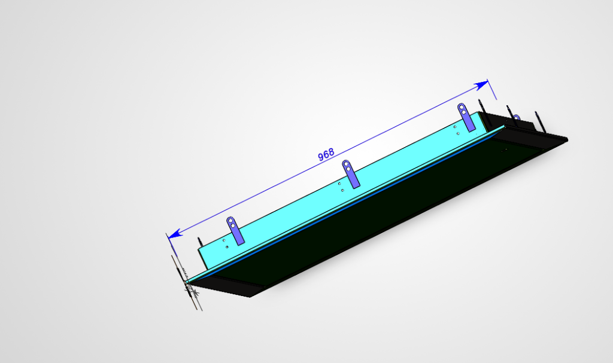
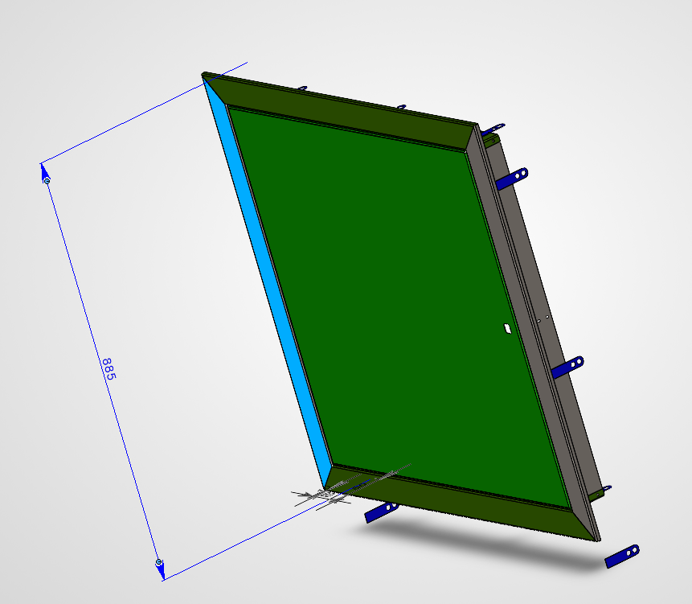
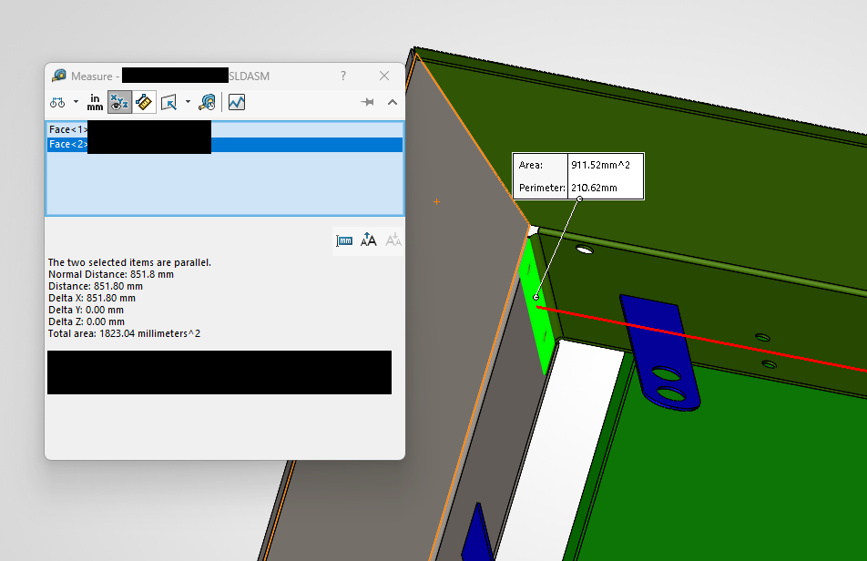
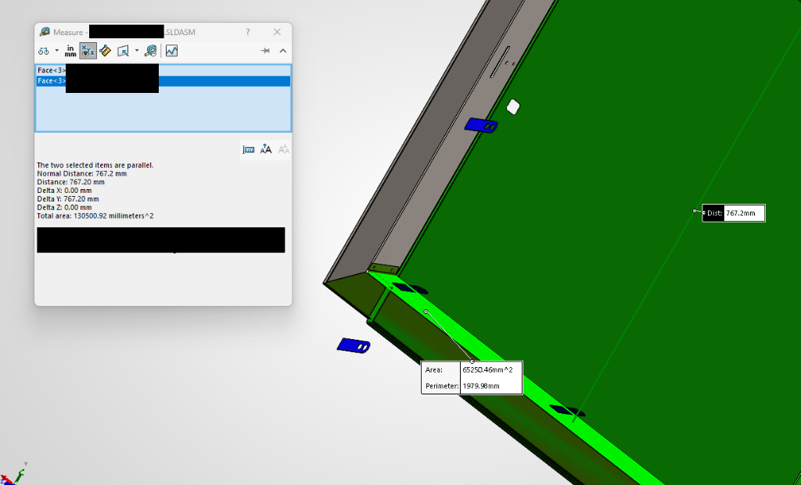
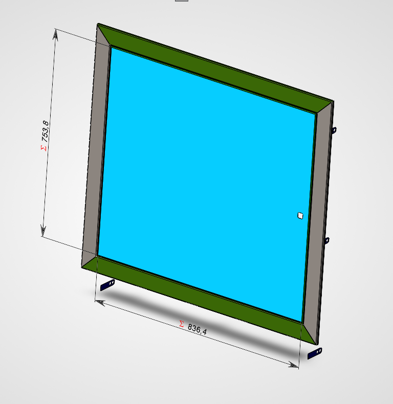

# CAD Guide: Measuring the 3D Model & Configuring Offsets / CAD Гід

*Available languages: [English](#english) · [Українська](#українська)*

---

<a name="english"></a>
## English: CAD Measurement Guide

HatchGrouper is designed for an **integrated single-piece bent sheet metal hatch** (where the internal box body and the outer trim flange are formed from a single unfolded sheet).

Due to sheet metal thickness (typically 1.0–1.5 mm), bending deduction, and tooling K-factor, the inner box body differs from the nominal trim frame by fixed bend offsets. Follow these 5 steps in your 3D CAD software (SolidWorks, Autodesk Inventor, PTC Creo, etc.) to configure the parameters for your production.

### Step 1: Measure Outer Trim Dimensions (W_trim × H_trim)
Measure the outermost flange dimensions of the front trim. This is the decorative frame that covers the wall niche from the room side.

| Dimension | Baseline Value | Description |
|---|---|---|
| **Trim Width** | `968.0 mm` | Outermost left-to-right flange edge |
| **Trim Height** | `885.0 mm` | Outermost top-to-bottom flange edge |


*Figure 1: Outer trim width (968.0 mm).*


*Figure 2: Outer trim height (885.0 mm).*

---

### Step 2: Measure Box Body Dimensions After Bending (W_box × H_box)
Using the CAD **Measure** tool, select two opposing parallel faces of the internal box body. Due to sheet metal bend deformation and material deductions, the result usually contains decimal fractions:

| Dimension | Baseline Value | Description |
|---|---|---|
| **Box Body Width** | `851.8 mm` | Distance between opposing side wall faces |
| **Box Body Height** | `767.2 mm` | Distance between top and bottom wall faces |


*Figure 3: Measuring width of internal box body in SolidWorks (851.8 mm).*


*Figure 4: Measuring height of internal box body in SolidWorks (767.2 mm).*

---

### Step 3: Calculate Bend Offsets (`TrimDiff`)
Subtract the box body size from the outer trim size:

```
TrimDiffW = TrimW - BoxW = 968.0 - 851.8 = 116.2 mm
TrimDiffH = TrimH - BoxH = 885.0 - 767.2 = 117.8 mm
```

Enter these values into the **Trim − box (W/H)** field: `116.2 / 117.8` (or in **Settings…**).
HatchGrouper automatically subtracts these bend deltas from the trim dimension to determine the exact box body size for manufacturing and drawing designations.

---

### Step 4: Measure Clear Opening and Door Dimensions (`HatchDiff`)
Measure the inner clear opening or the hatch door size:

| Dimension | Baseline Value | Difference from Trim |
|---|---|---|
| **Door Width** | `836.4 mm` | `HatchDiffW = 968.0 - 836.4 = 131.6 mm` |
| **Door Height** | `753.8 mm` | `HatchDiffH = 885.0 - 753.8 = 131.2 mm` |


*Figure 5: Inner hatch door opening (836.4 × 753.8 mm).*

Enter `131.6 / 131.2` into the **Trim − hatch (W/H)** field.

---

### Step 5: Mounting Tabs (Ears) & Box Depth
- **Mounting Tabs (`EarMm`):** Flat mounting plates on the box sides stick out by `1.0 mm/side` (configurable in `Ears, mm/side: 1`). The software accounts for them when ensuring the box freely fits the smallest wall niche without jamming.
- **Box Depth (`DepthMm`):** Standard depth into the wall (default: `80 mm`). Used for the **Drawing (W×H×D, mm)** callout column (e.g. `852 × 768 × 80`).

---

<a name="українська"></a>
## Українська: Гід по вимірюванню CAD моделі

HatchGrouper розроблено для **суцільногнутої конструкції ревізійного люка**, де внутрішнє тіло короба та зовнішня лиштва зігнуті з одного листа металу.

Через товщину металу (1,0–1,5 мм), радіуси згину та K-фактор K-гібки внутрішнє тіло короба відрізняється від крайнього габариту лиштви на фіксовані зміщення. Виконайте 5 простих кроків у вашій CAD-системі (SolidWorks, Inventor, КОМПАС тощо), щоб підставити точні параметри під ваше виробництво.

### Крок 1. Вимірювання габариту лиштви (W_trim × H_trim)
Виміряйте крайній зовнішній габарит лицьового відігнутого фланця (листви):
- **Ширина лиштви:** `968.0 мм`
- **Висота лиштви:** `885.0 мм`

### Крок 2. Вимірювання стінок короба після згину (W_box × H_box)
Інструментом **Measure (Виміряти)** поміряйте відстань між двома протилежними паралельними стінками короба:
- **Ширина короба:** `851.8 мм`
- **Висота короба:** `767.2 мм`

### Крок 3. Розрахунок дельти «Лиштва − короб» (TrimDiff)
```
TrimDiffW = Габарит лиштви (968.0) − Короб (851.8) = 116.2 мм
TrimDiffH = Габарит лиштви (885.0) − Короб (767.2) = 117.8 мм
```
Введіть ці значення у поле **«Лиштва − короб (Ш/В): 116,2 / 117,8»**.

### Крок 4. Світловий отвір та розмір дверцят люка (HatchDiff)
Виміряйте світловий отвір: `836.4 × 753.8 мм`.
- `HatchDiffW = 968.0 − 836.4 = 131.6 мм`
- `HatchDiffH = 885.0 − 753.8 = 131.2 мм`
Введіть ці числа у поле **«Лиштва − люк (Ш/В)»**.

### Крок 5. Вушка та глибина
- **Вушка (`1 мм/бік`):** товщина/виліт монтажних пластин на стінках. Враховуються при перевірці проходу короба в найвужчу нішу.
- **Глибина (`80 мм`):** стандартна глибина короба в стіну для позначення на кресленнях: `852 × 768 × 80`.
